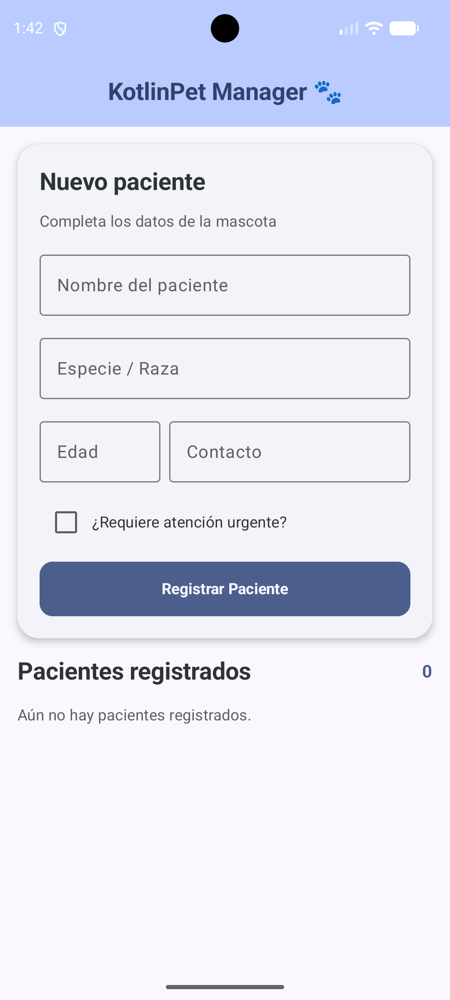
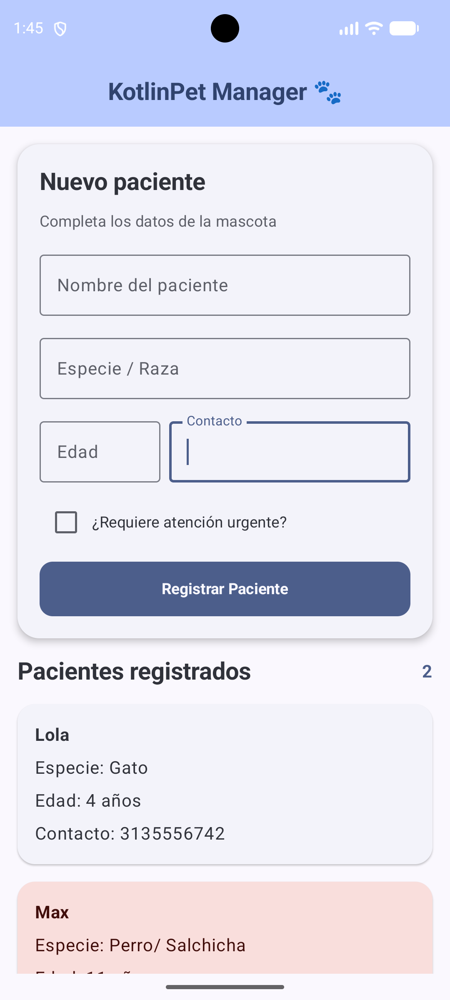
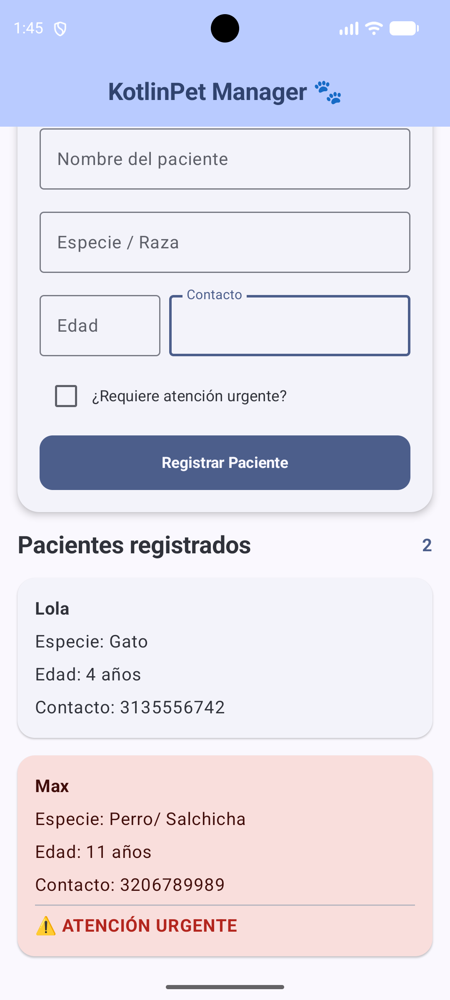

# 🐾 KotlinPet Manager v1.0

Aplicación móvil desarrollada en Kotlin para el registro y gestión de pacientes de una clínica veterinaria.

## 📚 Información académica

- **Asignatura:** Desarrollo de Aplicativos Móviles (EE053)
- **Proyecto:** Proyecto 1 - KotlinPet Manager v1.0
- **Estudiante:** Andrés Felipe Caicedo Mendez
- **Código:** 1112620909
- **Modalidad:** Individual

## 📱 Descripción del proyecto

KotlinPet Manager es una aplicación móvil desarrollada en Android Studio que permite registrar y visualizar pacientes de una clínica veterinaria.

El proyecto utiliza Jetpack Compose y Material Design 3 para construir una interfaz moderna e interactiva, aplicando la arquitectura MVVM para separar los datos, la lógica de negocio y la interfaz gráfica.

## ⚙️ Funcionalidades

- Registro de pacientes veterinarios.
- Ingreso de nombre, especie o raza y edad.
- Registro del contacto de emergencia.
- Identificación de pacientes que requieren atención urgente.
- Validación de los campos del formulario.
- Actualización automática de la lista de pacientes.
- Limpieza de los campos después de registrar.
- Contador de pacientes registrados.
- Visualización de pacientes mediante tarjetas.
- Diferenciación visual de pacientes urgentes.

## 🛠️ Tecnologías utilizadas

- Kotlin
- Android Studio
- Jetpack Compose
- Material Design 3
- Arquitectura MVVM
- Android ViewModel
- mutableStateOf
- Git y GitHub

## 🏗️ Arquitectura MVVM

La aplicación está organizada mediante tres capas:

### Model - Paciente.kt

Define la estructura de los pacientes mediante una data class con los atributos:

- id: Int
- nombre: String
- especie: String
- edad: Int
- contactoEmergencia: String
- esUrgencia: Boolean

### ViewModel - PacienteViewModel.kt

Administra la lógica y el estado de la aplicación.

Sus responsabilidades principales son:

- Mantener una lista observable de pacientes.
- Validar los datos ingresados.
- Registrar nuevos pacientes.
- Generar identificadores únicos.
- Actualizar los campos del formulario.
- Limpiar el formulario después de registrar.

### View - PantallaPrincipal.kt

Implementa la interfaz gráfica utilizando Jetpack Compose y Material 3.

Incluye:

- Scaffold y TopAppBar.
- Column y Row.
- OutlinedTextField.
- Checkbox y Button.
- LazyColumn.
- ElevatedCard.

La clase MainActivity.kt conecta el ViewModel con la interfaz.

## 📸 Capturas de pantalla

### 1. Pantalla principal

Interfaz inicial de la aplicación con el formulario vacío.

### 2. Pacientes registrados

Visualización de los pacientes registrados y contador actualizado.

### 3. Atención urgente

Identificación de pacientes urgentes mediante una tarjeta de color rojo.

## ▶️ Cómo ejecutar el proyecto

1. Clonar o descargar este repositorio.
2. Abrir el proyecto en Android Studio.
3. Esperar la sincronización de Gradle.
4. Seleccionar un emulador Android o dispositivo físico.
5. Ejecutar la aplicación desde la configuración `app`.
6. Registrar pacientes mediante el formulario principal.

**Versión mínima:** Android 8.0 (API 26).

## 🧪 Pruebas realizadas

Se verificaron las siguientes funcionalidades:

1. Registro de un paciente con datos válidos.
2. Registro de un paciente con atención urgente.
3. Validación de campos obligatorios.
4. Limpieza automática del formulario.
5. Actualización dinámica de la lista de pacientes.
6. Visualización de los pacientes registrados.

## 📝 Observaciones

Los pacientes registrados se mantienen temporalmente en el estado de la aplicación.

Los datos no se almacenan en una base de datos, por lo que pueden perderse al cerrar completamente la aplicación.

Este proyecto fue desarrollado con fines académicos para la asignatura Desarrollo de Aplicativos Móviles (EE053).

---

**KotlinPet Manager v1.0 | Proyecto académico**
